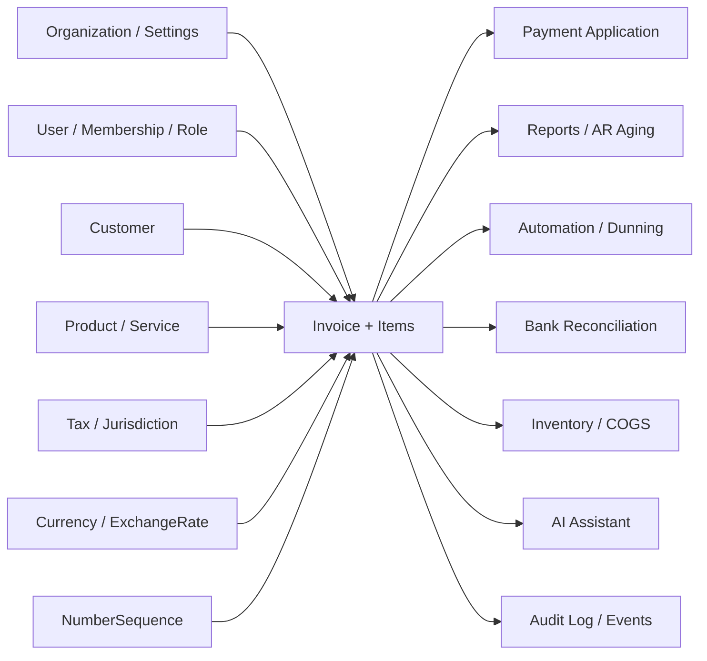

# ERP Platform — Architecture Decision Record: Invoice Module v1

Status: Approved baseline for implementation  
Scope: Multi-tenant accounting SaaS, starting with Invoices, designed for 18 future modules  
Scale assumption: 1,000 organizations · 10,000 users · 100,000+ invoices (10-year horizon: 10M+ rows)

---

## 0. Non-negotiable architecture decisions (ADR summary)

| # | Decision | Rejected alternative | Reason |
|---|---|---|---|
| A1 | Organization (`organizationId`) is the tenant root on **every** domain table | Single-tenant tables with `userId` | Every future module (banking, inventory, reports) is tenant scoped. Retrofitting a tenant key is a full-data rewrite. |
| A2 | Tenant isolation is enforced in a **Prisma client extension** (automatic `where organizationId` / create injection) + composite indexes starting with `organizationId` | Hand-written `where` in every query | One forgotten `where` is a data breach. Central enforcement is the only maintainable option at 10k users. |
| A3 | All money is `Decimal(19,4)` + ISO-4217 currency code + rate snapshot | `Float`, cents as `Int`, formatted strings | Float breaks reconciliation; cents-only breaks JPY/KWD and multi-currency. |
| A4 | Document state machine is a pure, tested module (`InvoiceStatusMachine`) | `if` statements in components/actions | State rules are shared by UI, actions, reports, automation and AI. |
| A5 | Invoice numbering via atomic `NumberSequence` row per org/type/branch/year | `max(id)+1` or `count()+1` | Gaps, races, and multi-branch collisions are inevitable otherwise. |
| A6 | Server Actions are **thin adapters** over application services (`InvoiceService`) | Business logic in `actions.ts` | Same logic must be callable from REST, queue workers, automation rules and AI tools later. |
| A7 | Mutations return a discriminated `Result<T>`; no exceptions cross the UI boundary | throw + `try/catch` in components | Typed errors are required for accessible inline form errors. |
| A8 | UI state (filters, sorting, pagination) lives in URL search params; ephemeral UI state in Zustand | All state in Zustand | URL state is shareable, back-button safe, cacheable and server-renderable. |
| A9 | Soft delete (`deletedAt`) + partial unique indexes from day one | Hard delete | Accounting data is legally retained; hard delete forces a rewrite of audit/export. |
| A10 | `AuditLog` (append-only) is generic across entity types | Invoice-only history table | Automation, banking, and AI all need one audit stream. |
| A11 | Keyset (cursor) pagination with `(createdAt, id)` | OFFSET only | OFFSET degrades linearly; 100k invoices is the point where it becomes visible. |
| A12 | Feature-based modules with a shared kernel (`lib/*`, `components/shared/*`) | Layer-by-type folders (`components/`, `pages/`, `utils/`) | Cross-module imports stay explicit; module extraction later is cheap. |

---

## STEP 1 — ARCHITECTURE ANALYSIS

### 1.1 Invoice Module Purpose

An invoice is a **legal, immutable-after-issue demand for payment** issued by one organization (tenant) to a customer. It is simultaneously:

- a **sales document** (what was sold, at what price, under which tax jurisdiction),
- a **receivable** (an amount owed, with due date and balance),
- an **accounting event** (revenue recognition, tax liability, AR ledger posting),
- an **audit artifact** (who created/sent/changed it and when),
- and the **input** to payments, cash-flow reporting, dunning automation and AI assistance.

Therefore the Invoice module must NOT own customers, products, taxes or payments. It **references** them through stable IDs and snapshots their immutable values at issue time.

Success criteria for v1:
1. Create/save a draft in < 2 interactions after customer selection.
2. Total, tax and balance never disagree between list, detail, print and API.
3. A sent invoice cannot be silently changed.
4. Every mutation is attributable and replayable.

### 1.2 Business Workflow

Canonical lifecycle (`InvoiceStatus`):

```
DRAFT ──send──> SENT ──view──> VIEWED ──payment──> PARTIALLY_PAID ──payment──> PAID
  │               │              │                    │
  └──cancel──> CANCELLED <────────┴────────────────────┘
                 (PAID cannot be cancelled; use Credit Note in a later phase)
```

`OVERDUE` is **not** a stored lifecycle state. It is a derived presentation state:
`status IN (SENT, VIEWED, PARTIALLY_PAID) AND dueDate < today AND balanceDue > 0`.
Storing it would require a nightly job and would drift from real time.

| From | Action | To | Guard | Side effects |
|---|---|---|---|---|
| DRAFT | SAVE | DRAFT | valid schema | `InvoiceEvent.UPDATED`, audit log |
| DRAFT | SEND | SENT | ≥1 line, customer with email, number assigned | assign number if missing, `SENT` event, outbox email row |
| DRAFT | CANCEL | CANCELLED | — | `CANCELLED` event |
| SENT | VIEW | VIEWED | first public view only | `VIEWED` event (once) |
| SENT/VIEWED/PARTIALLY_PAID | RECORD_PAYMENT | PARTIALLY_PAID / PAID | amount ≤ balanceDue | `PaymentApplication`, recompute balance, `PAYMENT_RECEIVED` event |
| SENT/VIEWED/PARTIALLY_PAID | EDIT | same status | reason required, snapshot revision | `InvoiceRevision`, audit log |
| SENT/VIEWED/PARTIALLY_PAID | CANCEL | CANCELLED | balanceDue = total | `CANCELLED` event |
| PAID/CANCELLED | any edit | — | blocked | typed `DomainError` |

All transitions go through `features/invoices/domain/status-machine.ts`. No component or action may write `status` directly.

### 1.3 User Roles

Roles are organization-scoped (a user can be Admin in org A and Viewer in org B).

| Role | Intent |
|---|---|
| OWNER | Full control, billing, member management; cannot be removed |
| ADMIN | Configure settings, taxes, numbering; full invoice access |
| ACCOUNTANT | Create/edit/approve invoices, manage payments, reports |
| FINANCE_MANAGER | Approve, send, record payments, view reports; no org settings |
| SALES_PERSON | Create/edit **own** drafts, request approval; cannot send paid items |
| VIEWER | Read-only, including exports |
| AUDITOR (future) | Read-only + audit log + immutable exports |

Ownership is modeled with `createdById`; SALES_PERSON scope is enforced in the service layer (`scope: 'own'`), not in the UI.

### 1.4 Required Permissions

Permission format: `resource:action`. Stored in `Permission` table so future modules add rows without code changes to the role model.

| Permission | OWNER | ADMIN | ACCOUNTANT | FINANCE_MANAGER | SALES_PERSON | VIEWER |
|---|:--:|:--:|:--:|:--:|:--:|:--:|
| `invoice:view` | ✓ | ✓ | ✓ | ✓ | ✓ (own) | ✓ |
| `invoice:create` | ✓ | ✓ | ✓ | ✓ | ✓ | — |
| `invoice:edit` | ✓ | ✓ | ✓ | ✓ | ✓ (draft/own) | — |
| `invoice:delete` | ✓ | ✓ | draft only | draft only | own draft | — |
| `invoice:approve` | ✓ | ✓ | ✓ | ✓ | — | — |
| `invoice:send` | ✓ | ✓ | ✓ | ✓ | — | — |
| `invoice:cancel` | ✓ | ✓ | ✓ | ✓ | — | — |
| `payment:record` | ✓ | ✓ | ✓ | ✓ | — | — |
| `customer:view/create/edit` | ✓ | ✓ | ✓ | view | create/edit | view |
| `report:view` | ✓ | ✓ | ✓ | ✓ | — | view |
| `audit:view` | ✓ | ✓ | — | — | — | — |

`requirePermission('invoice:send')` is called inside the service, never only in the component.

---

## STEP 2 — DEPENDENCY ANALYSIS

### 2.1 Upstream dependencies (Invoice consumes)

| Dependency | Why | Coupling rule |
|---|---|---|
| Organization + Settings | tenant, base currency, fiscal year, address, terms | Always from `TenantContext`, never a request param |
| User / Membership | author, approver, sender, ownership scope | Resolved from session |
| Customer | bill-to / ship-to legal identity | FK + **snapshot** name/address/email/tax ID onto invoice |
| Product/Service | line item source | FK + snapshot description, SKU, unit, price |
| Tax | rate, jurisdiction, inclusive/exclusive, compound | FK on join table + snapshot rate/name onto line |
| Currency + ExchangeRate | document currency and base-currency reporting | Store rate snapshot; never re-fetch historical rate |
| NumberSequence | legal invoice number | Atomic allocation in same DB transaction |
| Payment / PaymentApplication | balance due | Derived from applications; cached balance kept in sync |

### 2.2 Downstream dependencies (consume Invoice)

Payments, Receipts, Credit Notes, Dunning/Automation, AR Aging + P&L + GST/VAT reports, Bank reconciliation, Inventory cost of goods sold, AI "explain unpaid invoices", exports/e-invoicing (UBL/ZUGFeRD), public customer portal.

### 2.3 Dependency map



### 2.4 Coupling rules (anti-corruption)

- Invoices store **snapshots** (`customerNameSnapshot`, `itemDescriptionSnapshot`, `taxRateSnapshot`). Changing a product price never rewrites history.
- No module imports another module's Prisma models directly; cross-module reads go through `features/<module>/server/readers.ts` with narrow DTOs.
- `InvoiceService` depends on interfaces (`NumberAllocator`, `TaxCalculator`, `PaymentLedger`, `EventBus`) so payments/tax engines can be swapped without touching invoice code.

---

## STEP 3 — DATABASE ANALYSIS

### 3.1 Entity catalog

| Entity | Purpose | Key relationships | Future expansion |
|---|---|---|---|
| `Organization` | Tenant root; legal entity | 1→N memberships, customers, invoices, sequences | Multi-branch via `Branch`; group consolidation via `parentOrganizationId` |
| `OrganizationSetting` | Base currency, fiscal year, address, invoice defaults, numbering config | 1:1 Organization | Per-branch overrides |
| `Branch` | Legal/operating location | N:1 Organization; referenced by sequences, invoices | GST registration per branch, branch-level P&L |
| `User` | Identity (global) | N:N Organization via membership | MFA, SSO, preferences |
| `OrganizationMembership` | Tenant-scoped user assignment + status | N:1 User, Organization; 1:N roles | Invitations, seat billing |
| `Role` / `Permission` / `RolePermission` / `UserPermissionOverride` | RBAC + exceptions | Org-scoped roles | Custom roles, approval hierarchies |
| `Customer` | Bill-to identity | 1→N Invoices, Payments | Credit limit, statements, portal user, payment terms |
| `CustomerAddress` | Billing/shipping addresses | N:1 Customer | Address validation, tax jurisdiction lookup |
| `Product` | Sellable item/service | 1→N InvoiceItems | Inventory linkage, price lists, bundles |
| `Tax` | Reusable tax definition | N:N InvoiceItem via `InvoiceItemTax` | Tax groups, inclusive/compound, GST/VAT filing |
| `Currency` / `ExchangeRate` | ISO codes + dated rates | ExchangeRate 1→N invoices (snapshot) | Multi-base reporting, rate providers |
| `NumberSequence` | Atomic document numbering | N:1 org/branch/type/year | Reset policies, e-invoice prefixes |
| `Invoice` | Document header + money summary | N:1 Customer, Branch; 1→N Items, Events, Applications | Recurring, templates, e-invoice payload |
| `InvoiceItem` | Line | N:1 Invoice, optional Product | Kits, discounts, deferred revenue |
| `InvoiceItemTax` | Line ↔ tax with snapshot | N:1 Item, Tax | Compound tax ordering |
| `InvoiceRevision` | Immutable snapshot before edit | N:1 Invoice | Diff UI, legal evidence |
| `InvoiceEvent` | User-visible timeline | N:1 Invoice | Webhooks, automation triggers |
| `Payment` | Money received (independent of invoice) | N:1 Customer, 1→N Applications | Bank reconciliation, refunds |
| `PaymentApplication` | Allocation of payment to invoice | N:1 Payment, Invoice | Overpayment, unapplied cash |
| `AuditLog` | Append-only security/audit trail | Polymorphic entity ref | SIEM export, tamper-evident hash chain |
| `Attachment` | Polymorphic files | entityType + entityId | Virus scan, signed URLs |
| `BankAccount` / `BankTransaction` | Future banking | Org-scoped, transaction→payment link | Feeds, reconciliation rules |
| `Warehouse` / `InventoryMovement` | Future inventory | Product → movement → invoice item | Valuation methods, stock reservations |

### 3.2 Keys, FKs and required indexes

All tenant tables: `id UUID PK DEFAULT gen_random_uuid()`, `organizationId UUID NOT NULL FK → Organizations.id ON DELETE RESTRICT`.

| Table | Required indexes | Notes |
|---|---|---|
| `Organizations` | `slug UNIQUE` | |
| `OrganizationMemberships` | `UNIQUE(organizationId, userId)`, `(userId, status)` | |
| `Users` | `email UNIQUE`, `(status)` | |
| `Customers` | `UNIQUE(organizationId, customerNumber)`, `(organizationId, displayName)` GIN trigram, `(organizationId, createdAt DESC)` | |
| `Products` | `UNIQUE(organizationId, sku)`, `(organizationId, name)` | |
| `Taxes` | `UNIQUE(organizationId, name, jurisdiction)` | |
| `NumberSequences` | `UNIQUE(organizationId, branchId, documentType, period, scopeKey)` | row lock on allocate |
| `Invoices` | `(organizationId, createdAt DESC, id DESC)`, `(organizationId, status, dueDate)`, `(organizationId, customerId, createdAt DESC)`, `UNIQUE(organizationId, invoiceNumber) WHERE deletedAt IS NULL`, GIN on `(organizationId, invoiceNumber)` trigram, `(organizationId, baseCurrency, issueDate)` for reports | partial unique needs raw SQL migration |
| `InvoiceItems` | `(invoiceId, position)` UNIQUE | |
| `InvoiceItemTaxes` | UNIQUE(invoiceItemId, taxId) | |
| `Payments` | `(organizationId, customerId, paidAt DESC)`, `(organizationId, paymentNumber)` | |
| `PaymentApplications` | UNIQUE(paymentId, invoiceId), `(invoiceId)` | |
| `InvoiceEvents` | `(invoiceId, createdAt DESC)` | |
| `AuditLogs` | `(organizationId, createdAt DESC)`, `(entityType, entityId, createdAt DESC)`, `(actorId, createdAt DESC)` | append-only, partitioned by month later |
| `ExchangeRates` | UNIQUE(fromCurrency, toCurrency, rateDate) | |

All list indexes lead with `organizationId` so tenant filtering is index-friendly.

### 3.3 Normalization review

- **1NF/2NF:** satisfied; no repeating groups, line taxes in a join table, all non-key attributes depend on the whole key.
- **3NF:** satisfied for transactional truth. Deliberate, controlled denormalization:
  - `Invoice.subtotal/taxAmount/total/amountPaid/balanceDue` are **derived caches** for list filtering and reporting. They are updated only by `PaymentLedger` / `TotalsCalculator` inside a transaction and verified by a nightly invariant job.
  - Snapshot columns on `Invoice`/`InvoiceItem` are historical facts, not duplicates of live master data.
- **BCNF consideration:** `ExchangeRate` keyed by `(from,to,date)`; invoice stores the rate snapshot, so no transitive dependency on a mutable rate table.
- **Not normalized on purpose:** `AuditLog` JSONB payloads (append-only evidence, never queried relationally).

### 3.4 Performance strategies

Decimal money; no floats. Monthly `AuditLog` + `InvoiceEvent` partitioning after 5M rows. Hot-list projection view `InvoiceListRow` (join to customer + derived overdue flag) as a Prisma view or a normalized `invoice_search` cache table if measured necessary. `pg_trgm` for fuzzy search. Read replicas for reports (route via `PrismaReadClient`). Connection pooling via PgBouncer/Supabase pooler; Prisma extension uses `SET LOCAL` only inside explicit transactions.

---

## STEP 4 — FUTURE COLLISION ANALYSIS

| Severity | Risk | Collision scenario | Resolution strategy |
|---|---|---|---|
| HIGH | Missing tenant key on a future table | A 2027 "BankRule" table forgets `organizationId` → cross-tenant leak | Enforce via Prisma extension (throws if model in tenant registry has no org filter), plus a CI schema test asserting every tenant model has `organizationId` and a leading composite index. |
| HIGH | Money as float / currency-free | Reconciliation drift, wrong VAT, impossible multi-currency | Decimal(19,4) + currency code + rate snapshot; `Money` value object; lint rule banning `number` for money fields. |
| HIGH | Tax logic baked into invoice UI | GST/VAT/inclusive/compound requires rewriting every form | `TaxCalculator` strategy + `InvoiceItemTax` snapshots; tax engine is a separate module from day 1. |
| HIGH | Invoice number from ID/count | Duplicate numbers across branches; legal invalidity | `NumberSequence` with row lock and unique index. |
| HIGH | Edits mutate issued invoices silently | Audit/legal failure once e-invoicing arrives | Status machine + `InvoiceRevision` + reason required. |
| MEDIUM | `status = OVERDUE` stored | Nightly job, stale UI, reporting mismatch | Derived predicate in queries/selectors. |
| MEDIUM | Payments modeled as `invoice.status = PAID` only | Cannot handle one payment covering many invoices or partial/refund | Independent `Payment` + `PaymentApplication`. |
| MEDIUM | Single address on customer | GST/VAT needs jurisdiction per branch/ship-to | `CustomerAddress` + `Branch` from v1 schema. |
| MEDIUM | Hard-coded permissions in components | Custom roles break everything | Permission table + `requirePermission` in services. |
| MEDIUM | Audit log per module | Fragmented compliance story | Generic `AuditLog` + `InvoiceEvent` split (internal vs user-visible). |
| MEDIUM | UI filters only in component state | No deep links, broken back button, no server caching | URL search params as canonical query state. |
| LOW | Polymorphic `Attachment` without FK | Orphan files | Nightly cleanup + typed `EntityType` enum. |
| LOW | Localized date/number formatting ad hoc | Inconsistent invoices per locale | `Intl` formatters in `lib/format`, driven by org locale/timezone. |
| LOW | Prisma model names leaking into UI | Renames ripple through screens | DTO mapping at service boundary (`InvoiceListItem`, `InvoiceDetail`). |
| LOW | `deletedAt` without partial unique indexes | Reusing a deleted invoice number | Raw SQL partial unique indexes in migration. |

---

## STEP 5 — UI/UX ARCHITECTURE

### 5.1 Screens and intent

| Screen | Primary job | Secondary jobs |
|---|---|---|
| **Invoice List** | Find the right invoice in < 5 seconds | Triage overdue, bulk send/export, see cash position |
| **Create Invoice** | Produce a correct draft with minimal typing | Customer lookup, item lookup, live totals, save-and-new |
| **Invoice Detail** | Answer "what is owed and what happened?" | Record payment, send, print/PDF, timeline, revisions |
| **Edit Invoice** | Correct a draft safely | Clear diff of what changed, reason for issued invoices |

### 5.2 User flow

```
List ──New Invoice──> Create (draft)
  │                     ├─ Save draft ──────────> Detail (toast: "Draft saved")
  │                     └─ Save & Send ─────────> Detail (status SENT, email queued)
  ├── row click ─────> Detail ──Edit──> Edit ──Save──> Detail
  ├── row action ────> Send / Cancel / Duplicate / Download
  └── filter chips ──> List (URL updated, shareable)
```

### 5.3 Layout system

Desktop-first 12-column shell: persistent left icon+label nav (240px), sticky top bar with org switcher + global search + user menu, content max-width 1440px. Tablet (768–1023px): icon rail (72px), content full width, detail summary becomes a right sidebar below 1100px. Mobile (<768px): bottom tab bar, full-width cards, sticky bottom action bar on create/edit, detail summary collapses into an accordion.

### 5.4 States (every screen)

| State | Treatment |
|---|---|
| Empty (no invoices) | Illustration-free centered panel: "Create your first invoice", secondary "Import CSV" (disabled with tooltip until phase 2 — no fake affordances). |
| Empty (filtered) | "No invoices match these filters" + **Clear filters** action (never the generic empty state). |
| Loading | Suspense skeletons shaped exactly like the table/header; no spinners over existing content. |
| Error | Inline error summary at top with `role="alert"`, field-level messages tied via `aria-describedby`, retry action. |
| Success | Sonner toast + optimistic status badge; no blocking modal for routine actions. |
| Destructive | Confirmation dialog naming the invoice number and consequence. |

### 5.5 UX reasoning

- **Stripe-like table density** (compact rows, subtle dividers, monospaced numbers) because accounting users scan numbers, not cards.
- **Linear-like command surface**: `⌘K` style global search and keyboard-first row navigation; filters are chips, not a hidden accordion.
- **Notion-like detail**: single scroll with a sticky summary panel, timeline at the bottom — document feel, familiar to non-accountants.
- **Zoho-like accounting rigor**: explicit status badges, due-date aging colors, tax breakdown visible before save.
- Currency is always shown with code (`$1,240.00 USD`) to prevent cross-tenant/cross-currency ambiguity.
- All icons are `aria-hidden`; every interactive element has a visible focus ring; tables use proper `<th scope>`, sort buttons expose `aria-sort`.

---

## STEP 6 — REUSABLE COMPONENT STRATEGY

| Component | Location | Reuse across | Anti-duplication rule |
|---|---|---|---|
| `DataTable` | `components/shared/data-table` | Invoices, Customers, Products, Payments, Reports | Headless TanStack wrapper; only column defs are feature-owned |
| `SearchBar` | `components/shared/search-bar` | Every list + global search | Debounced, URL-bound via `useQueryState` helper |
| `FilterPanel` / `FilterChips` | `components/shared/filters` | All lists | Filters declared as config arrays, not JSX |
| `StatusBadge` | `components/shared/status-badge` | Invoices, Payments, Orders, Expenses | Status→variant map in `lib/display/status.ts`, not in component |
| `FormField` | `components/shared/form-field` | All forms | Wraps RHF `Controller` + label + error + a11y wiring |
| `CurrencySelector` / `MoneyInput` | `components/shared/money` | Invoices, Products, Expenses, Reports | Single `Money` type; Intl formatting in one place |
| `DatePicker` | `components/shared/date-picker` | All documents | Org timezone/locale from context |
| `ActionMenu` | `components/shared/action-menu` | All row/toolbar actions | Actions supplied as data with permission flags |
| `Drawer` / `Modal` / `ConfirmDialog` | `components/shared/overlays` | Customer quick-create, line item picker, destructive confirms | One focus-trap implementation (Radix) |
| `PageHeader` / `EmptyState` / `ErrorState` | `components/shared/feedback` | Every screen | Standardized copy + icon set |
| `SectionCard` / `SummaryCard` | `components/shared/layout` | Detail pages across modules | Slot-based, no feature imports |
| `SuspenseTableSkeleton` | `components/shared/feedback` | All lists | Skeleton geometry from column config |

`components/ui/*` contains only generated shadcn/Radix primitives. Feature components compose `components/shared/*`; they never restyle primitives inline with one-off CSS.

---

## STEP 7 — FOLDER STRUCTURE

```
invoice/
├── docs/ARCHITECTURE.md
├── prisma/
│   ├── schema.prisma
│   ├── migrations/
│   └── seed.ts
├── src/
│   ├── app/
│   │   ├── (auth)/                     # future sign-in, accept invite
│   │   ├── (platform)/
│   │   │   ├── layout.tsx              # app shell: nav, org switcher, session guard
│   │   │   ├── dashboard/page.tsx
│   │   │   └── invoices/
│   │   │       ├── page.tsx            # LIST
│   │   │       ├── new/page.tsx        # CREATE
│   │   │       ├── [id]/page.tsx       # DETAIL
│   │   │       └── [id]/edit/page.tsx  # EDIT
│   │   ├── api/v1/invoices/            # REST adapter (external/e-invoicing/future AI)
│   │   ├── globals.css
│   │   └── layout.tsx                  # fonts, providers, html lang
│   ├── components/
│   │   ├── ui/                         # shadcn primitives (generated, do not hand-edit logic)
│   │   └── shared/                     # cross-feature composed components
│   ├── config/
│   │   ├── app.ts                      # constants (no magic values)
│   │   ├── navigation.ts               # nav model, permission-aware
│   │   └── permissions.ts              # canonical permission registry
│   ├── features/
│   │   └── invoices/
│   │       ├── actions/                # Server Actions ('use server', thin)
│   │       ├── components/             # list/, create/, detail/, shared/
│   │       ├── domain/                 # pure: status machine, totals, invariants
│   │       ├── hooks/                  # client hooks (form, query state)
│   │       ├── schemas/                # Zod request schemas
│   │       ├── server/                 # InvoiceService, readers, mappers
│   │       └── types/                  # DTOs shared across layers
│   ├── lib/
│   │   ├── auth/                       # session abstraction (Auth.js slot)
│   │   ├── db/                         # Prisma client + tenant extension + tx helper
│   │   ├── errors/                     # Result, error codes, error → response mapper
│   │   ├── format/                     # money, date, number, status display
│   │   ├── money/                      # Money value object
│   │   ├── query/                      # pagination, URL query state, sorting
│   │   ├── rbac/                       # requirePermission, scope helpers
│   │   ├── tenancy/                    # TenantContext, tenant registry
│   │   └── utils.ts                    # cn() only
│   └── middleware.ts                   # session/tenant cookie validation
├── tests/
│   ├── unit/                           # domain + money + RBAC tests
│   └── e2e/                            # Playwright user journeys (phase 2)
├── components.json
├── tailwind.config.ts
├── tsconfig.json
└── package.json
```

**Folder purpose rule:** a file may import downward (`app → features → lib`) or sideways within its own feature. A feature may never import another feature's internals; use that feature's `server/readers.ts` DTOs.

---

## STEP 8 — API DESIGN

### 8.1 Contract conventions

All mutations are Server Actions returning:
```ts
type Result<T> =
  | { ok: true; data: T }
  | { ok: false; error: { code: ErrorCode; message: string; fieldErrors?: Record<string, string[]> } };
```
Validation: Zod parse at the adapter boundary → service re-validates domain invariants. Authorization inside the service. Errors mapped from `DomainError | ValidationError | AuthorizationError | NotFoundError | ConflictError`.

### 8.2 Endpoints / actions

| Operation | Adapter | Request | Success response | Errors |
|---|---|---|---|---|
| List invoices | `listInvoices(query)` (server component reader) | `{q?, status?, cursor?, limit≤100, sort, customerId?, dateFrom?, dateTo?}` | `{items: InvoiceListItem[], nextCursor?, total?}` | 400 invalid query, 403 |
| Get invoice | `getInvoice(id)` | `{id}` | `InvoiceDetail` (items, events, payments, totals) | 404, 403 |
| Create invoice | `createInvoice(input)` | customerId, currencyCode, issueDate, dueDate, lines[{productId?, description, quantity, unitPrice, taxIds[], discount}], notes, reference | `InvoiceDetail` (DRAFT) | VALIDATION, CUSTOMER_INVALID, TAX_INVALID, FORBIDDEN |
| Update invoice | `updateInvoice(id, input, expectedVersion)` | same + `version` for optimistic lock | `InvoiceDetail` | CONFLICT (stale version), INVALID_TRANSITION, FORBIDDEN |
| Delete invoice | `deleteInvoice(id)` | `{id}` | `{id}` | INVALID_TRANSITION (not draft), FORBIDDEN |
| Send invoice | `sendInvoice(id)` | `{id, sendEmail?}` | `{status, sentAt, emailQueued}` | INVALID_TRANSITION, CUSTOMER_NO_EMAIL, FORBIDDEN |
| Cancel invoice | `cancelInvoice(id, reason)` | `{id, reason}` | `{status}` | INVALID_TRANSITION, FORBIDDEN |
| Record payment | `recordPayment(input)` | invoiceId, amount, currency, paidAt, method, reference | `{paymentId, balanceDue, status}` | AMOUNT_EXCEEDS_BALANCE, FORBIDDEN |
| Duplicate invoice | `duplicateInvoice(id)` | `{id}` | new `InvoiceDetail` (DRAFT) | NOT_FOUND, FORBIDDEN |
| REST v1 | `GET/POST /api/v1/invoices`, `GET/PATCH/DELETE /api/v1/invoices/:id`, `POST /:id/send` | same schemas via Zod | JSON + standard status codes | RFC 9457-style problem+json |

REST handlers call the **same** `InvoiceService`; no logic duplication. All endpoints are tenant-scoped by session, never by a client-supplied org ID.

---

## STEP 9 — SECURITY REVIEW

| Area | Risk | Mitigation |
|---|---|---|
| Authentication | Stolen session, session fixation | Auth.js with httpOnly + Secure + SameSite=Lax cookies, rotating session, `middleware.ts` guard; session abstraction today, provider swappable later |
| Authorization | IDOR across tenants | Tenant extension injects org filter; service calls `requirePermission` + `assertTenantEntity`; ID lookups always include `organizationId` in the `where` |
| RBAC | Privilege creep | Deny-by-default permission registry; role permissions seeded, overrides audited; checks server-side only |
| Input validation | Malformed/oversized payloads | Zod at adapter + service boundary; max line items, max string lengths, currency allowlist from DB; `z.coerce` for numeric form strings |
| Sensitive data | PII/customer emails in logs | AuditLog redaction list; never log request bodies; structured logs with entity IDs only |
| Injection | SQL injection | Prisma parameterized queries; raw SQL only for fixed partial indexes, no string interpolation |
| CSV/formula injection | Exports execute formulas | Prefix `=+-@` with `'` on export (phase 2) |
| Audit logging | Missing evidence | Append-only `AuditLog` written in same transaction as mutation, with actor, IP, UA, correlationId; no update/delete route |
| CSRF | Cross-site mutation | Server Actions origin check + SameSite cookies; REST requires CSRF token for cookie auth or API key |
| Rate limiting | Enumeration/abuse | Per-org + per-user limits on send/search/export at edge (phase 1 auth) |
| File uploads | Malware | Signed URLs, content-type allowlist, size cap, virus scan (phase 2) |
| Multi-tenancy | RLS gaps | Prisma extension + schema CI test + optional Postgres RLS using `app.current_organization_id` set via `SET LOCAL` in interactive transactions |

---

## STEP 10 — PERFORMANCE REVIEW

- **Indexes:** tenant-leading composite indexes listed in §3.2; partial unique on active invoice number; trigram GIN for search; covering index `(organizationId, status, dueDate, balanceDue)` for aging/overdue filters.
- **Pagination:** keyset using `(createdAt, id)` with `WHERE (createdAt, id) < (:cursorAt, :cursorId) ORDER BY createdAt DESC, id DESC LIMIT n+1`; count query executed separately and only when `includeTotal=true`.
- **Query shape:** select only columns needed by `InvoiceListItem` (approx. 12 fields), never `include` all relations for lists; detail uses one query with `select` + 2 small relation queries in `Promise.all`.
- **Sorting:** allowlisted sort columns mapped to Prisma `orderBy` — never pass user strings directly.
- **Search:** prefix `startsWith` on indexed invoice number + trigram fallback; customer name via indexed join; debounce 300ms; URL-bound.
- **Caching:** static config (currencies, permissions) in memory; report aggregates via materialized view refreshed hourly; React `cache()` for per-request readers.
- **Writes:** totals computed in memory from submitted lines, persisted once; payment recalculation in a single interactive transaction with `SELECT ... FOR UPDATE` on the invoice row to prevent lost updates.
- **Budgets:** list p95 < 300ms at 100k invoices; create < 200ms excluding network; no N+1 (enforced by a test that counts queries).

---

## STEP 11 — IMPLEMENTATION PLAN

| Phase | Scope | Priority | Dependencies | Risk |
|---|---|---|---|---|
| **1 — Foundation** (this delivery) | Next.js 15 skeleton, Prisma schema (all core ERP entities), tenant extension, RBAC registry, Result/errors, Money, shadcn primitives, shared components, Invoice domain (status machine + totals), InvoiceService, 4 screens, seed data | P0 | PostgreSQL URL | Schema mistakes propagate; mitigated by full entity catalog now |
| **2 — Completeness** | Auth.js + org onboarding, Customers/Products/Taxes CRUD, number allocation endpoint, REST v1, Payments + balance ledger, email outbox, PDF, unit + Playwright tests, CI gates | P0 | Phase 1 | Payment concurrency; mitigated by row locks |
| **3 — Scale & expansion** | Reports/AR aging, inventory + branch, bank feed/reconciliation, automation/dunning, AI assistant tools, read replicas, partitioning, e-invoicing, observability | P1 | Phase 2 | Data volume; mitigated by indexes + keyset pagination designed in v1 |

Exit gate for Phase 1: `npm run lint`, `npm run typecheck`, `npm test`, `npm run build` all pass.

---

## STEP 12 — FINAL ARCHITECTURE REVIEW

1. **What could break later?** Tenant filter omitted on a new model; money stored ad hoc in a new module; a component writing `status` directly; invoice number generated outside `NumberSequence`; an un-awaited payment recalculation causing stale balance.
2. **Which decisions are future-proof?** Organization root + tenant extension, Decimal money + currency snapshots, status machine, service layer under Server Actions, generic audit, polymorphic attachments, URL query state, feature-based folders, keyset pagination.
3. **Which decisions must be avoided?** Hard deletes, float money, stored `OVERDUE`, module-local audit logs, permission checks in JSX, business logic in route handlers, `count()+1` numbering, direct cross-feature Prisma imports.
4. **What would force a rewrite?** Missing tenant key on core tables; wrong money representation; issued invoices mutated without revisions; payments tied 1:1 to invoices; numbering derived from IDs.
5. **How do we prevent it?** Schema CI assertions (every tenant model has `organizationId` + leading index), lint rules (no float money, no direct `prisma.*` in features), centralized status machine + tenant extension, architectural review checklist in PR template, and domain unit tests that encode the invariants above.

---

## Phase 1 implementation scope (Step 13)

Implemented below against this approved architecture:

- Prisma schema with the full core ERP entity catalog and tenant-safe indexes.
- Shared kernel: `Result`, error taxonomy, tenant context/Prisma extension, RBAC guard, `Money`, formatters, query helpers.
- Invoice domain: status machine, totals calculator with tax snapshots, invariants.
- `InvoiceService` + thin Server Actions returning typed results.
- Reusable shadcn primitives + shared composed components.
- Four App Router screens: list, create, detail, edit — responsive, accessible, with loading/empty/error/success states.
- Domain unit tests and verification commands.
